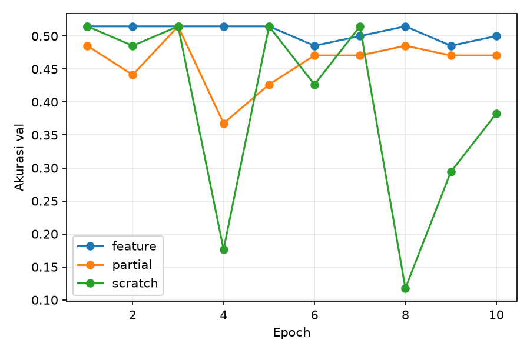

## Eksperimen 1: Kaggle saja (results_eksp1_kaggle_saja/)
Akurasi val ≈ 36–64%, setara menebak satu kelas. Hampir semua foto robot ditebak Bike. Penyebab: domain gap antara foto katalog Kaggle dan foto kamera robot.

## Eksperimen 2: Kaggle + foto robot terang (results_eksp2_kaggle_robot/)

| Mode | Akurasi val terbaik | Waktu latih | Epoch acc ≥ 90% |
|---|---|---|---|
| feature | 51,5% | 233,2 s | - |
| partial | 51,5% | 315,7 s | - |
| scratch | 51,5% | 487,9 s | - |

Akurasi 51,5% sama dengan proporsi kelas Car di val (35 dari 68 foto), dan confusion matrix menunjukkan hampir semua foto val ditebak Car. Dugaan penyebab: foto robot di train tidak seimbang (59 Car vs 20 Bike).

## Latensi
Diukur di laptop (CPU, input 1×3×224×224, 20 kali warm-up, 100 kali ukur). Belum diukur di mini PC robot.

| Model | Rata-rata | p95 | FPS |
|---|---|---|---|
| ResNet-18 | 44,9 ms | 67,9 ms | 22,2 |
| MobileNetV3-Small | 19,0 ms | 25,7 ms | 52,6 |

Anggaran inferensi ±35 ms dari 67 ms per frame (target 15 FPS). MobileNetV3-Small memenuhi anggaran, sedangkan ResNet-18 melebihinya.

## Analisis
- Hipotesis awal (feature dan partial lebih baik dari scratch) belum terbukti, karena ketiga mode gagal mengenali foto kamera robot dan akurasinya setara menebak satu kelas.
- Loss training turun baik di semua mode, tetapi akurasi val tidak ikut naik. Ini menunjukkan domain gap yang besar antara foto Kaggle dan foto kamera robot.
- Keterbatasan: val